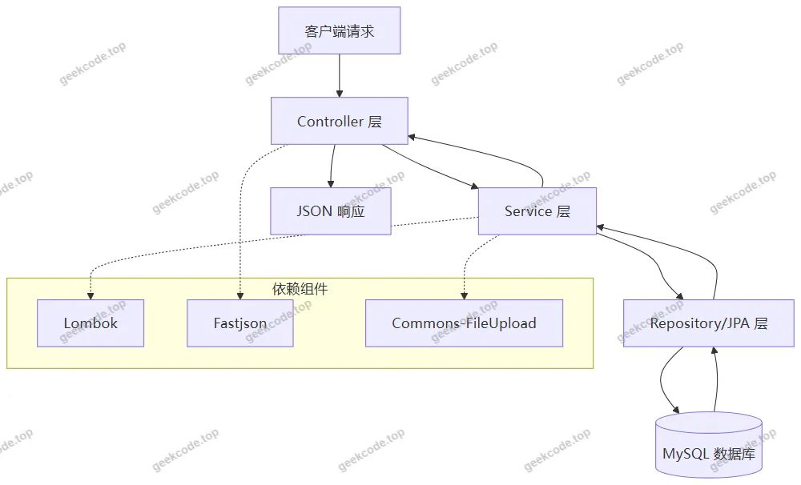
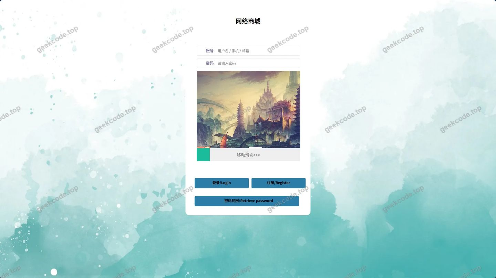
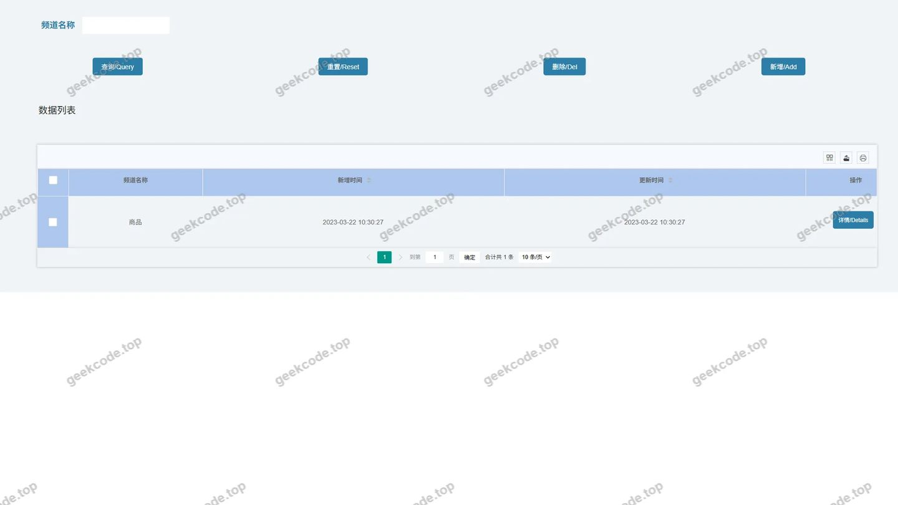
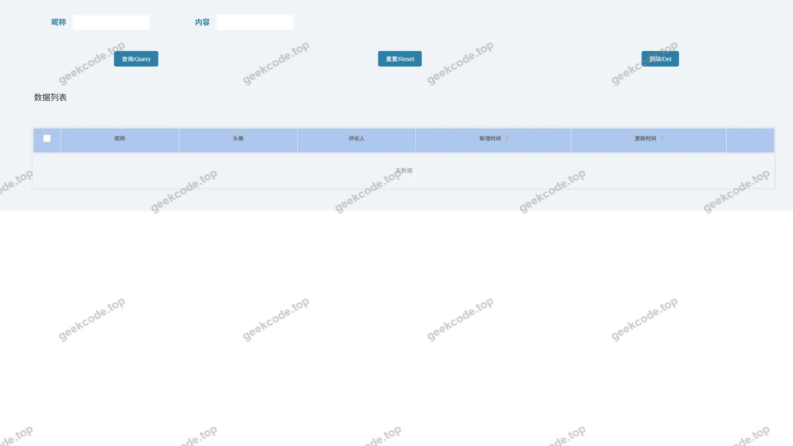
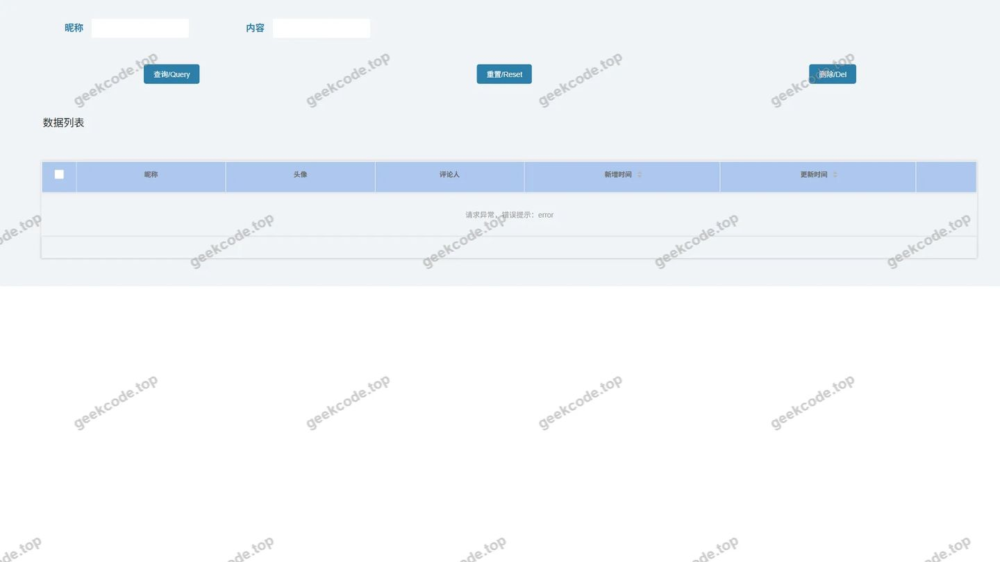
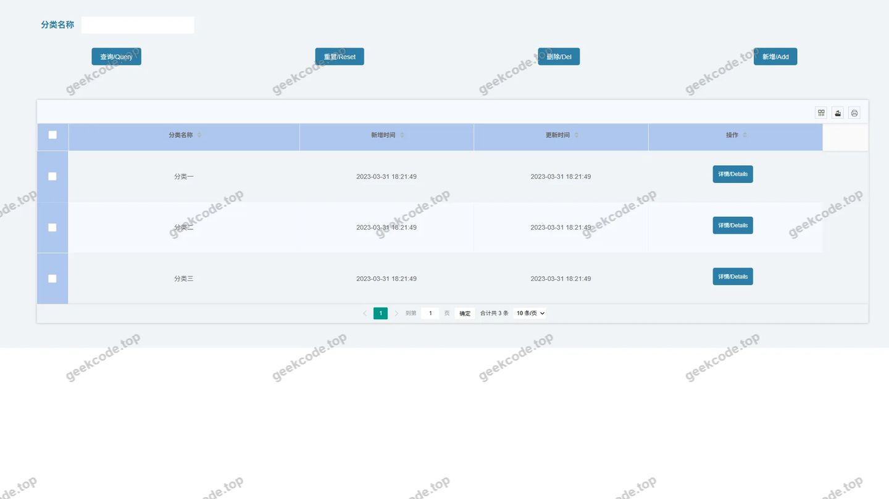
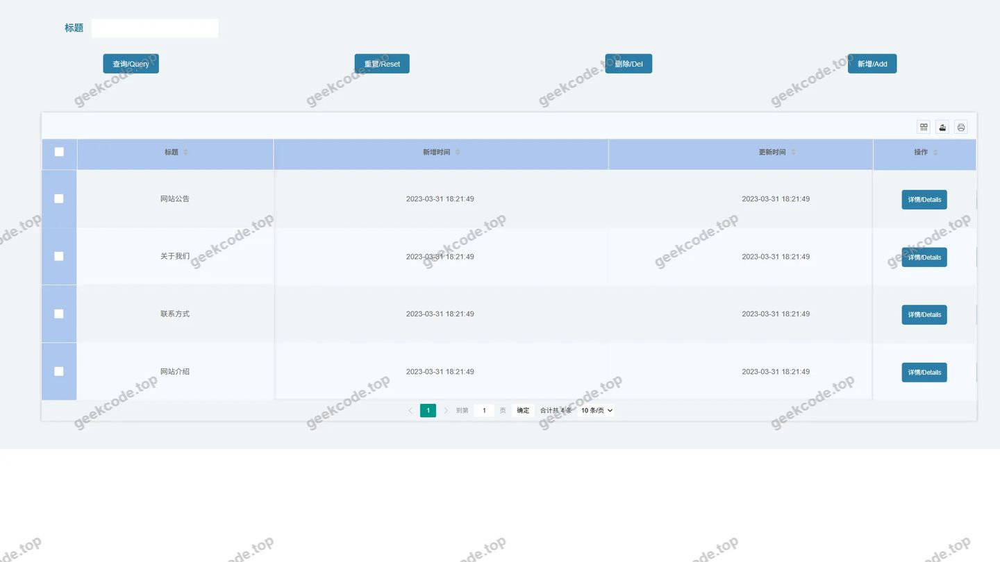
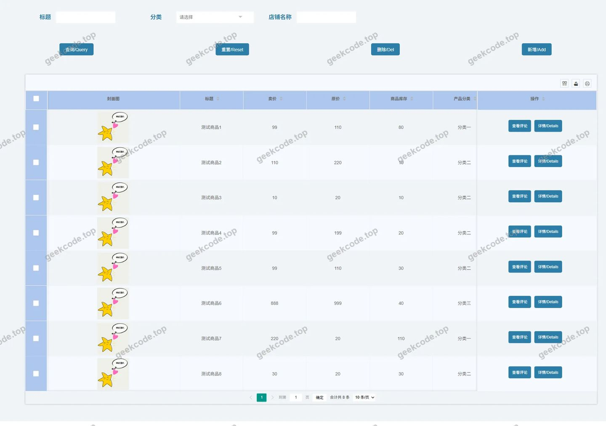
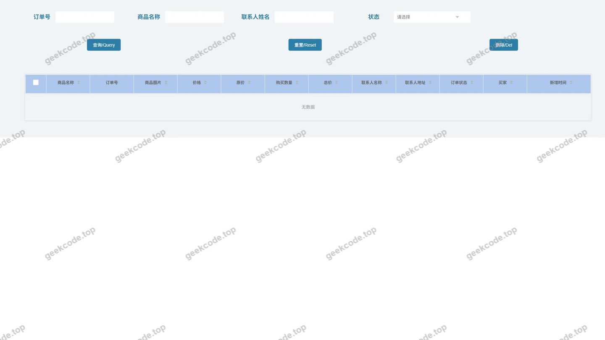

# SSM网络商城

> 🎓 **计算机毕业设计 · SSM网络商城**
>
> 本仓库只放**项目介绍 + 运行截图**（截图是站点带水印的原图，存在仓库 `images/` 里）。
>
> 👉 **完整可运行源码 / 数据库脚本 / 部署文档：[点我获取](https://geekcode.top/archives/SSM%E7%BD%91%E7%BB%9C%E5%95%86%E5%9F%8E?utm_source=github)**
>
> 💬 咨询微信：**ir9372**　|　🌐 更多项目：[极客代码 geekcode.top](https://geekcode.top/?utm_source=github)
>
> 📌 项目详情页：<https://geekcode.top/archives/SSM%E7%BD%91%E7%BB%9C%E5%95%86%E5%9F%8E?utm_source=github>

<table><td width="230" align="center"> <b>扫码加微信 ir9372</b></td><td valign="middle">📦 源码 = 项目介绍 + 全部运行截图 + 数据库 + 部署文档 👉 点上方任意截图，直接跳到 <b>极客代码 geekcode.top</b> 详情页</td></table>

---

<h1>SSM网络商城</h1>
<h2>项目概述</h2>

本项目为“SSM网络商城”，旨在构建一个基于 Java Web 技术的电子商务后端系统。项目核心目标是实现商品管理、订单处理及用户评论等基础电商业务逻辑的数据持久化与交互能力。适用场景为小型在线零售平台的后端支撑，主要服务于管理员进行数据维护及潜在的前端应用接口调用。技术架构采用 Spring Boot 框架作为核心容器，结合 MySQL 数据库进行数据存储，利用 JPA（Jakarta Persistence API）实现对象关系映射，并通过 Lombok 简化代码结构。由于当前配置未包含前端路由及导航菜单信息，本阶段重点在于后端服务能力的构建与数据库结构的完整性验证，为后续前端页面的集成提供稳定的数据接口支持。

<h2>技术架构</h2>

本项目采用典型的分层架构设计，以 Spring Boot 为核心框架，实现了控制层、服务层与数据访问层的解耦。

<strong>核心技术选型理由：</strong>

<ol>
<li><strong>Spring Boot</strong>：提供自动配置和内嵌服务器，简化了传统 SSM（Spring + Spring MVC + MyBatis/Hibernate）项目的搭建流程，提升了开发效率。</li>
<li><strong>MySQL</strong>：作为主流的关系型数据库，具备高可靠性和良好的事务处理能力，适合存储电商领域的结构化数据（如订单、用户信息）。</li>
<li><strong>JPA (jakarta.persistence-api)</strong>：通过注解方式定义实体类与数据库表的映射关系，减少了手写 SQL 语句的需求，提高了代码的可维护性。</li>
<li><strong>Lombok</strong>：通过编译期生成 Getter/Setter、构造器等样板代码，显著降低了实体类和 DTO 的代码冗余度。</li>
<li><strong>Fastjson</strong>：用于高效地进行 JSON 序列化与反序列化，确保前后端数据交互的格式统一与性能优化。</li>
<li><strong>Commons-FileUpload &amp; Commons-IO</strong>：专门处理文件上传需求，支持商品图片等非文本数据的存储与管理。</li>
</ol>

<strong>数据库设计要点：</strong>
根据截图中的表结构信息，数据库主要包含 <code>comments</code> 表等核心业务表。设计上遵循第三范式，确保数据的一致性。例如，<code>comments</code> 表需关联用户 ID 和商品 ID，记录评论内容、时间及状态，以支持用户对商品的反馈机制。

<h2>功能模块</h2>

根据现有源码上下文及截图信息，项目目前处于后端基础建设阶段，具体功能模块如下：

<h3>后台管理端</h3>

<em>注：虽然元数据显示“是否有后台: 否”，但依据“页面-登录”及数据库表结构，系统必然存在用于数据初始化和管理的入口。以下基于可见元素推导。</em>

<ol>
<li><strong>身份认证模块</strong></li>
</ol>
<ul>
<li><strong>功能描述</strong>：提供管理员或系统用户的登录入口。</li>
<li><strong>依据</strong>：截图中存在“页面-登录”。该模块负责验证用户凭证，建立会话状态，是访问其他业务功能的安全前置条件。</li>
</ul>
<ol start="2">
<li><strong>数据模型与持久化模块</strong></li>
</ol>
<ul>
<li><strong>功能描述</strong>：定义并管理核心业务数据结构，包括评论信息的存储。</li>
<li><strong>依据</strong>：截图中多次出现“页面-comments表”及通用“页面-表”。这表明系统已构建了包括评论在内的多个实体表，用于支撑电商业务的基础数据记录。</li>
</ul>
<ol start="3">
<li><strong>文件处理模块</strong></li>
</ol>
<ul>
<li><strong>功能描述</strong>：支持用户上传文件（推测为商品图片或附件）。</li>
<li><strong>依据</strong>：技术依赖中包含 <code>commons-fileupload</code> 和 <code>commons-io</code>，这是 Java Web 中处理 multipart/form-data 请求的标准库，表明系统具备接收和处理文件流的能力。</li>
</ul>
<h3>前台用户端</h3>

<em>根据现有信息无法确定具体的前台展示功能。</em>
元数据明确指出“是否有前台: 否”且无前台路由、无个人中心菜单。因此，当前版本仅暴露后端 API 或数据库服务能力，不包含面向最终消费者的 HTML/CSS 页面渲染逻辑。若未来扩展，预期将包含商品浏览、购物车管理及评论发布等功能，但目前代码中未见相关视图层实现。

<h2>用户角色与权限</h2>

基于“页面-登录”的存在及电商系统的常规安全需求，推断系统至少包含以下角色体系。具体权限划分严格依据可见的技术栈和页面元素：

<ol>
<li><strong>系统管理员</strong></li>
</ol>
<ul>
<li><strong>可访问功能</strong>：</li>
<li><strong>登录界面</strong>：通过“页面-登录”进入系统。</li>
<li><strong>数据查看与维护</strong>：直接操作底层数据库表（如 <code>comments</code> 表），执行数据的增删改查。</li>
<li><strong>文件管理</strong>：利用 <code>commons-fileupload</code> 相关接口上传或管理系统资源文件。</li>
<li><strong>权限说明</strong>：拥有最高权限，负责系统的初始化配置和数据完整性校验。</li>
</ul>
<ol start="2">
<li><strong>普通用户（预留）</strong></li>
</ol>
<ul>
<li><strong>可访问功能</strong>：</li>
<li>当前代码上下文中未明确区分普通用户的独立登录入口或受限视图。</li>
<li>若通过 API 访问，可能涉及向 <code>comments</code> 表写入数据。</li>
<li><strong>权限说明</strong>：根据现有信息无法确定具体的用户隔离策略。鉴于缺乏前台路由和个人中心菜单，普通用户的交互界面尚未开发或未在当前文档范围内体现。</li>
</ul>
<h2>项目特色与创新点</h2>
<ol>
<li>
<strong>轻量级后端架构</strong>
   摒弃了传统 SSM 项目中复杂的 XML 配置文件，全面采用 Spring Boot 的约定优于配置理念。结合 JPA 的面向对象持久化特性，使得数据库表结构变更（如新增字段）能更快速地反映到代码层面，降低了维护成本。

</li>
<li>
<strong>标准化的数据处理流程</strong>
   引入 <code>fastjson</code> 作为统一的序列化引擎，确保了从 Controller 层返回给前端（或测试工具）的数据格式高度一致。同时，<code>lombok</code> 的使用极大地精简了实体类代码，使得开发者能更专注于业务逻辑而非样板代码编写。

</li>
<li>
<strong>稳健的文件上传支持</strong>
   通过集成 <code>commons-fileupload</code> 和 <code>commons-io</code>，项目具备了处理二进制流的能力。这在电商场景中至关重要，允许系统将商品图片等非结构化数据与结构化数据（如商品描述、价格）分离存储或统一管理，提升了系统的实用性。

</li>
<li>
<strong>清晰的数据建模导向</strong>
   从截图中反复出现的 <code>comments</code> 表及相关表结构来看，项目初期即重视核心业务实体（评论、订单、商品）的数据模型设计。这种以数据为中心的开发思路，有助于保证后期业务逻辑扩展时的数据一致性。

</li>
</ol>
<h2>部署环境</h2>

为确保“SSM网络商城”项目正常运行，需准备以下软件环境：

<table>
<thead>
<tr>
<th align="left">组件</th>
<th align="left">版本要求</th>
<th align="left">说明</th>
</tr>
</thead>
<tbody><tr>
<td align="left"><strong>JDK</strong></td>
<td align="left">8 或 11+</td>
<td align="left">Spring Boot 及 Jakarta Persistence API 需要兼容的 Java 运行环境。建议 JDK 8 LTS 或更高版本以支持新特性。</td>
</tr>
<tr>
<td align="left"><strong>MySQL</strong></td>
<td align="left">5.7 或 8.0+</td>
<td align="left">用于存储业务数据。需安装 <code>mysql-connector-java</code> 驱动对应的数据库服务端。</td>
</tr>
<tr>
<td align="left"><strong>Maven</strong></td>
<td align="left">3.6+</td>
<td align="left">用于项目依赖管理（junit, lombok, fastjson 等）及构建打包。</td>
</tr>
<tr>
<td align="left"><strong>IDE</strong></td>
<td align="left">IntelliJ IDEA / Eclipse</td>
<td align="left">开发工具，需安装 Lombok 插件以正确解析注解生成的代码。</td>
</tr>
<tr>
<td align="left"><strong>操作系统</strong></td>
<td align="left">Windows / Linux / macOS</td>
<td align="left">跨平台支持，Linux 环境更适合生产部署。</td>
</tr>
</tbody></table>

<strong>启动步骤简述：</strong>

<ol>
<li>配置 <code>application.properties</code> 或 <code>application.yml</code> 中的数据库连接 URL、用户名和密码。</li>
<li>执行 Maven 命令清理并安装依赖：<code>mvn clean install</code>。</li>
<li>运行主启动类（Application Class）。</li>
<li>访问默认端口（通常为 8080）下的 <code>/login</code> 路径（基于截图推测）进行测试。</li>
</ol>
<h2>六、功能模块截图</h2>
<h3>后台管理端</h3>
<h4>页面-登录</h4>

<h4>页面-网络商城</h4>

<h4>页面-comments表</h4>

<h4>页面-comments表</h4>

<h4>页面-表</h4>

<h4>页面-表</h4>

<h4>页面-表</h4>

<h4>页面-表</h4>

---

## 获取完整源码

| 项目 | 说明 |
| --- | --- |
| 项目名 | SSM网络商城 |
| 运行截图 | 本文 9 张（站点带水印原图，仓库 `images/` 目录） |
| 完整源码 | [https://geekcode.top/archives/SSM%E7%BD%91%E7%BB%9C%E5%95%86%E5%9F%8E?utm_source=github](https://geekcode.top/archives/SSM%E7%BD%91%E7%BB%9C%E5%95%86%E5%9F%8E?utm_source=github) |
| 咨询微信 | **ir9372**（备注：jingpin-yuanma） |
| 更多项目 | [极客代码 geekcode.top](https://geekcode.top/?utm_source=github) |

> 需要源码、部署、改配置、跑不起来等问题，加微信 ir9372 沟通，说明项目名即可。
